# 谋全局 EnBrain

> 以「全量事实为底座」的企业诊断 Agent 方案。**当前处于需求与方案设计阶段，未落地、无真实项目交付**——对外表述以此为准。
> 本仓开源的是**方法与方案**（对外需求稿 + 可交互原型），**不含实现代码、不含商业与过程材料**。

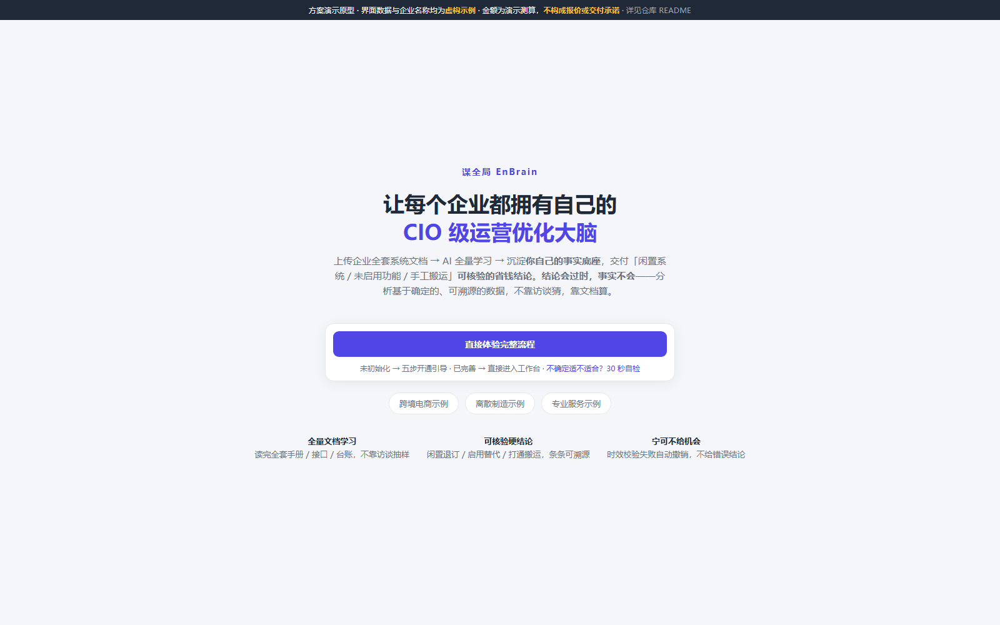

## 一、当前状态

| 项 | 值 |
| --- | --- |
| 需求文档 | **`docs/谋全局EnBrain-需求说明书（对外版）.md`** —— 对外唯一需求稿（能力 · 边界 · 指标与验收 · **六项已知未决项**） |
| 原型 | `prototype.html`（40+ 页面全量交互）、`system-prototype/index.html`（诊断引擎） |
| 交付方法 | `docs/交付准备/`（就绪度评估 · 交付模板 · 作业 SOP · 复核规程） |
| 证据 | `experiments/公开文档实测记录.md`（成立 3 条 + 证伪 1 条，含复算命令） |
| 发布范围 | 本仓只发布对外需求稿、交付方法与原型；PRD 正文、详细规格、商业材料、过程台账、历史留档与第三方语料置于 `internal/`，**不随仓发布** |

## 二、它能做什么

读完文档只要记一件事：**它把企业已有的系统文档变成可对账的结论，交付后资产留在客户手里。**

| 能力 | 怎么做 | 你获得什么 |
| --- | --- | --- |
| **事实底座** | 读完全套手册 / 接口 / 制度 / 台账，沉淀六层可溯源知识（系统 · 功能 · 流程 · 数据结构 · 集成 · 规则） | 每条结论都能回到原文，不靠顾问经验 |
| **可核验的硬节省** | 识别闲置系统、买了没启用的功能、手工搬运三类浪费，金额带算式与来源 | 能直接拿去和财务、业务对账的钱 |
| **可落地的机会** | 六类浪费 → 六种落地方式，按 ALI（落地难度 × 价值）排序 | 知道先做哪一件，而不是一堆建议 |
| **诊断报告** | 一份结论四种语言：专业版 / 人话版 / 汇报版 / 合规应答 | 老板能汇报、员工能看懂、CIO 能核对 |
| **执行档案** | 只记状态与验收，不做甘特与排期 | 边界清晰：不做项目管理供应商 |
| **员工侧** | 我的智囊（问答 + 赋能包）、我的贡献（献策，未采纳必给理由） | 一线愿意用，而不是被考核 |

**不做什么**（详见对外稿 §0.1 八条放弃清单）：不碰业务数据、不靠访谈猜、不做计划管理、不允许「问题越多越显专业」、不自动拍板。

## 三、界面速览

> 以下截图取自 `prototype.html` 实际渲染（1600×1000，演示数据，企业名称与金额均为虚构示例），对应 v1.2。

### 3.1 一次诊断，三类视图

| | |
| --- | --- |
| 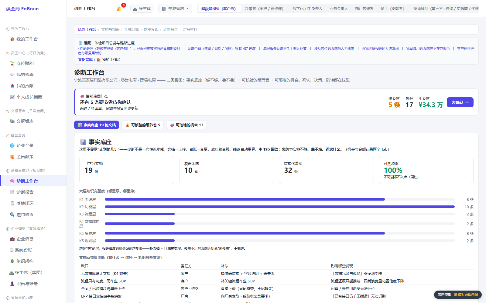 | 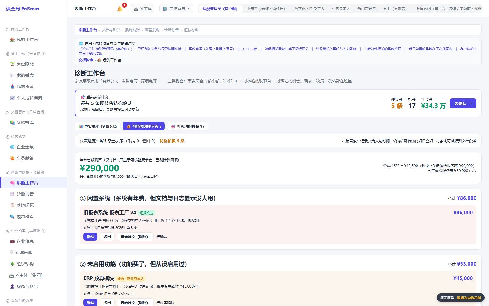 |
| **事实底座**：六层知识逐条可溯源，先回答「我的事实够不够、准不准」 | **可核验的硬节省**：每笔金额带算式与来源，状态可确认 / 驳回 |
| 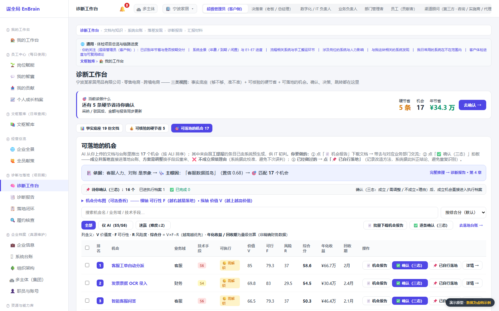 | 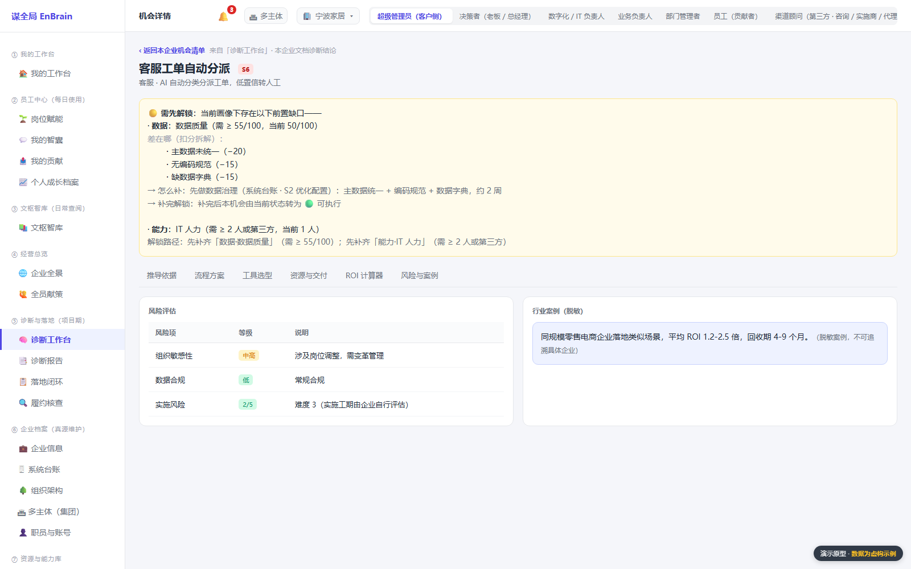 |
| **可落地的机会**：按 ALI 排序，标注「已自落地 / 候补」 | **推导依据**：这条机会怎么来的——事实 → 落差 → 结论 |

### 3.2 结论与边界

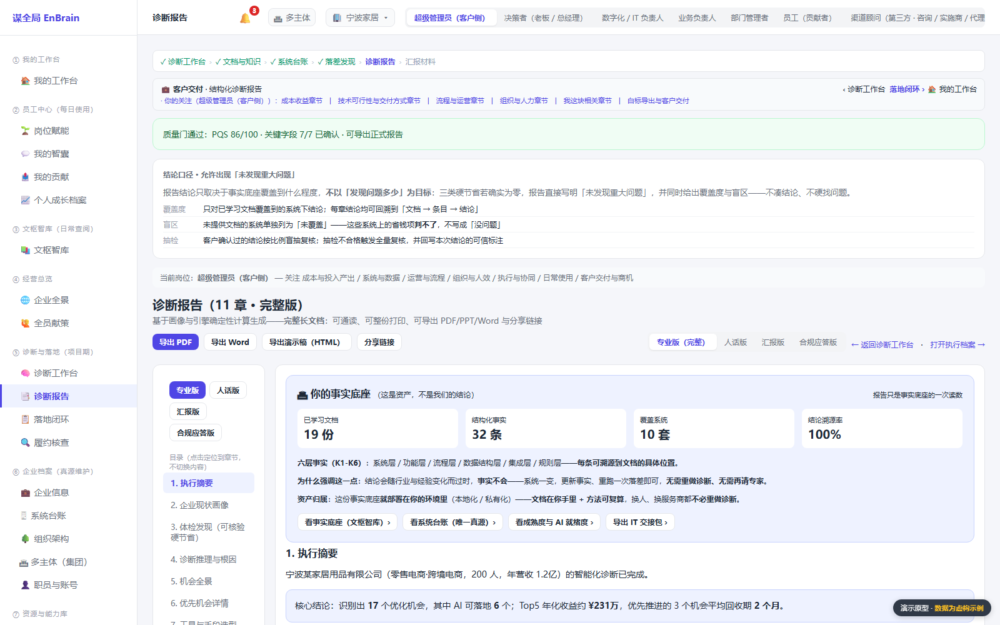

**诊断报告**：质量门通过才出正式版，四模式切换；首屏第二块就是「结论口径」——正面声明**允许「未发现重大问题」**，并给出覆盖度 / 盲区 / 抽检三条口径。诚实边界写在界面上，不只在文档里。

### 3.3 资产与执行

| | |
| --- | --- |
| 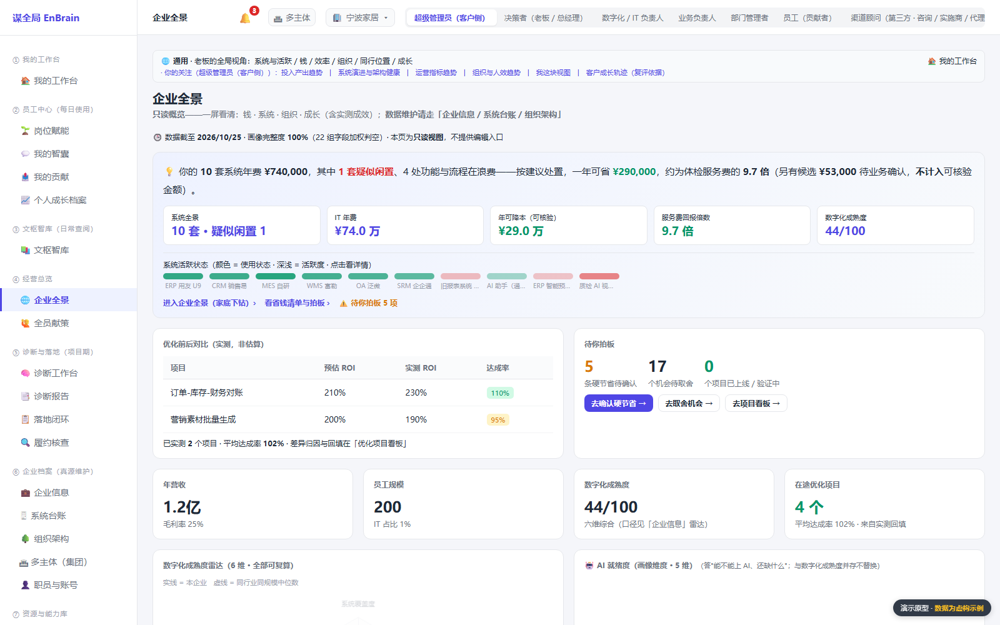 | 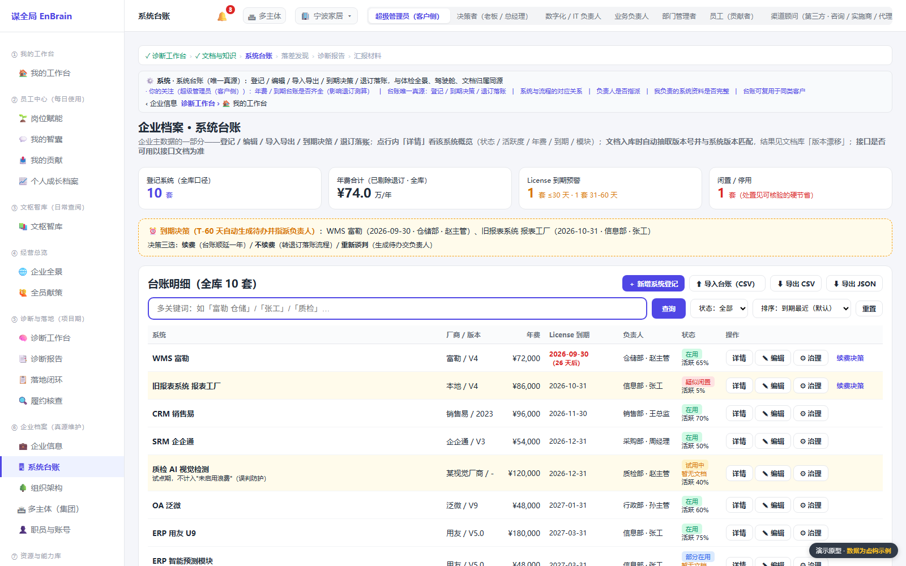 |
| **企业全景**：系统 · 年费 · 到期 · 闲置，一张台账 | **系统台账**：唯一真源，改一处全链生效 |
| 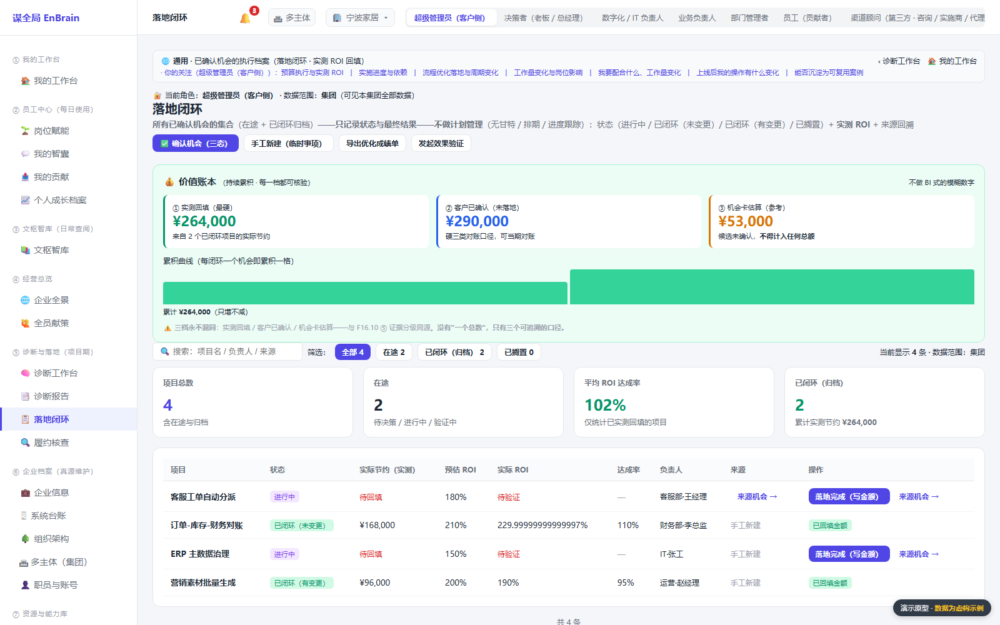 | 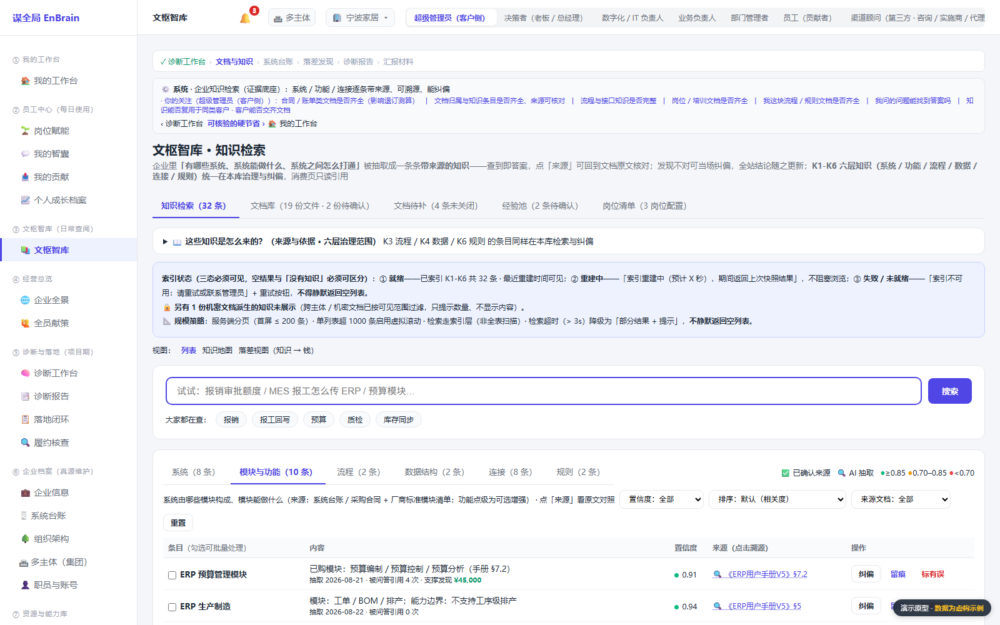 |
| **落地闭环**：状态与验收，不做计划管理 | **文枢智库**：事实底座的可浏览形态，可下钻到原文 |

### 3.4 一线视角

| | |
| --- | --- |
| 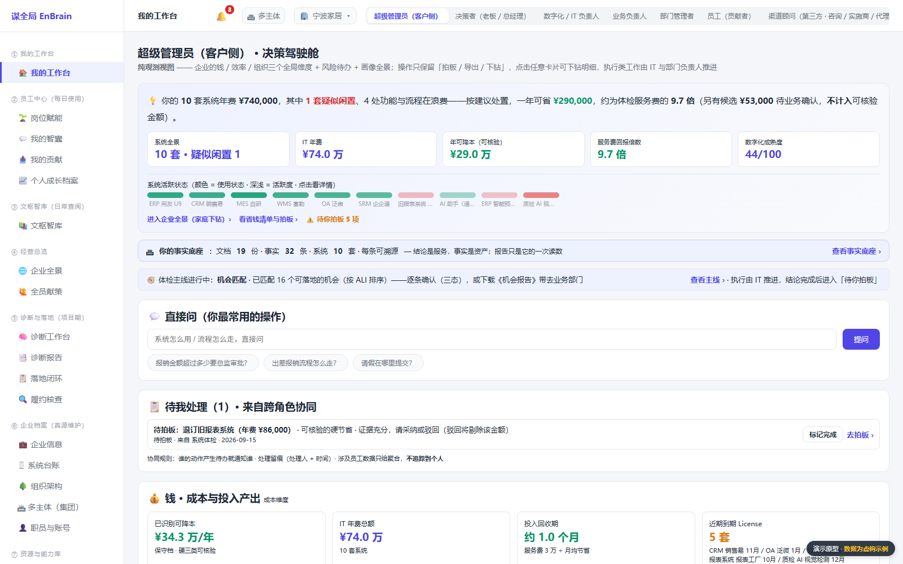 | 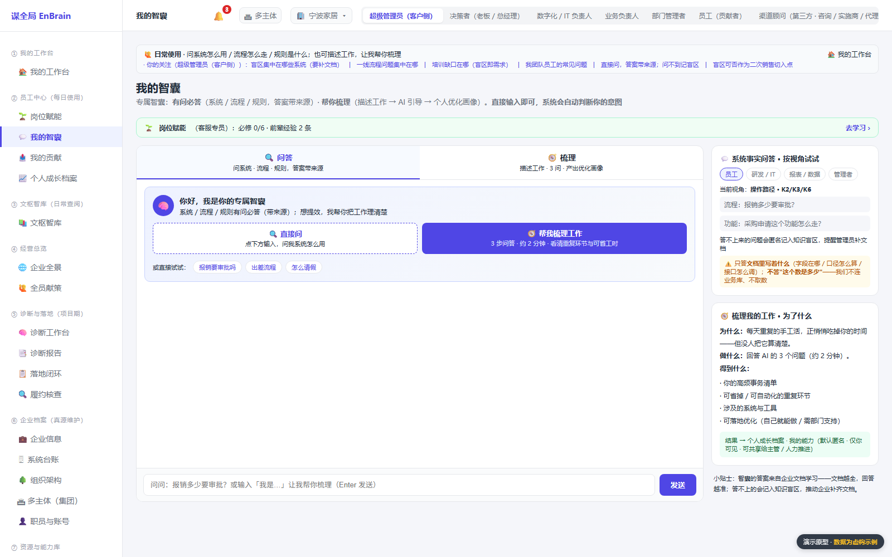 |
| **我的工作台**：按关注维度组装的个人首页 | **我的智囊**：带着企业事实回答问题，不胡说 |

## 四、目录

| 路径 | 内容 |
| --- | --- |
| `docs/` | 对外需求稿、路演版、交付方法（`交付准备/`）、界面截图（`assets/`） |
| `prototype.html` | 页面级全量原型（单文件；图表库走 CDN，需联网） |
| `system-prototype/` | 核心诊断引擎原型（`index.html` + `engine.js`，无外部依赖） |
| `experiments/` | 公开文档实测记录（语料不随仓发布，抓取方式见记录） |
| `tools/` | **只依赖公开文件**的审计脚本（`verify.py`、`audit_*.py`、`corpus_stats.py`），在仓库根运行 |
| `internal/` | **不发布**：PRD 正文与详细规格、商业与单位经济、过程台账、历史留档、第三方语料、内部工具 |
| `LICENSE` / `CHANGELOG.md` / `CONTRIBUTING.md` | 双许可（脚本 MIT · 文档 CC BY 4.0）· 版本变更 · 参与与质疑方式 |

## 五、阅读顺序

1. `docs/谋全局EnBrain-需求说明书（对外版）.md` —— **先读 §0 一页纸**（判断 / 三条主张 / 八条主动放弃）→ 再通读全文（含「哪些还没验证」）
2. `docs/交付准备/` —— 能不能接单（B1）、怎么交付（B2/B3）、谁来复核（B5）
3. `prototype.html` —— 40+ 页面的可交互原型（路线见下节）
4. `experiments/公开文档实测记录.md` —— 唯一一条可独立复算的实测证据

## 六、5 分钟演示路线（`prototype.html` 逐屏）

| # | 看哪 | 该看出什么 |
| --- | --- | --- |
| 1 | 落地页 → 「直接体验完整流程」 | 声明条（演示数据虚构）· 30 秒自检入口 |
| 2 | 诊断工作台 **Tab1 事实底座** | 六层知识（K1–K6）逐条可溯源，不是一张画像表 |
| 3 | 诊断工作台 **Tab2 可核验的硬节省** | 三类省钱项 + 金额算式 + 确认状态（可对账） |
| 4 | 诊断工作台 **Tab3 可落地的机会** | 机会卡与 ALI / ROI 排序，不是建议清单 |
| 5 | 任一机会 → **推导依据** | 「这条机会怎么来的」——事实 → 落差 → 结论 |
| 6 | **诊断报告** → 切换四模式 | 专业 / 人话 / 汇报 / 合规应答，同一份结论四种语言 |
| 7 | **执行档案** | 只有状态与验收，没有甘特与排期（「不做计划管理」的边界） |
| 8 | 员工侧 **我的智囊 / 我的贡献** | 赋能包与献策的可见性、未采纳必给理由 |
| 9 | **诊断报告页顶部 · 结论口径** | 正面声明「允许未发现重大问题」+ 覆盖度 / 盲区 / 抽检——诚实边界写在界面上，不只在文档里 |

> 走完全程约 5 分钟；每屏都能回答「用户拿它做什么决策」，而不是「系统怎么工作」。

## 七、一图看懂

```
企业已有文档（用户手册 / 接口文档 / 制度 SOP / 数据库设计）
        │  ① 接入 + 文档类型判定（防把运维文档当功能清单）
        ▼
六层可溯源事实底座 ── K1 系统 · K2 功能 · K3 流程 · K4 数据结构 · K5 集成 · K6 规则
        │  ② 落差识别：文档说「有」 × 实际「怎么用」（K2×K3 / K5×K3）
        ▼
两类结论 ── 可对账的硬节省（闲置 / 未启用 / 手工搬运）
        └── 可落地的机会（六类浪费 → 六种落地方式 S1–S6）
        │  ③ 三态确认（成立并落地 / 方案需调整 / 不成立，驳回须给理由）
        ▼
执行档案（状态 + 验收标准，不做计划管理）──▶ 回填实测 ROI ──▶ 下一版事实更新
```

**一句话**：结论会过时，事实不会——所以交付的是留在企业手里、可自行复算的事实底座，报告只是它的一次读数。

## 八、文档地图

| 类别 | 文档 |
| --- | --- |
| 需求本体 | 需求说明书（对外版，对外唯一需求稿） |
| 交付方法 | 文档就绪度评估（B1）、交付模板包（B2）、诊断作业 SOP（B3）、专家复核规程（B5） |
| 表达 | 路演版、原型、界面截图（`docs/assets/`） |
| 证据 | 公开文档实测记录（成立 3 条 + 证伪 1 条） |

## 九、工作约定

1. **真源唯一**：需求语义以 `docs/谋全局EnBrain-需求说明书（对外版）.md` 为准，交互以 `prototype.html` 为准；两者不一致时回写而非各自解释。
2. **零残留检索**：每轮修订后，对修订记录中每个「删除/改写/降级」对象跑全库关键词检索，残留 >0 不发布（防注释式修订）。
3. **对外口径**：方案阶段，未落地；不宣称已交付能力，不宣称提分 / 降本数字；「人天 / 准确率 / 单位经济」一律标注为设计目标或估算。
4. **数字可复算**：出现在文档里的实测数字，必须能在 `tools/` 或 `experiments/` 里找到复算方式。
5. **截图与原型同源**：`docs/assets/` 的截图必须由 `prototype.html` 实际渲染产生，**界面改版须重截**并更新版本标注。

## 十、发布边界（重要）

`internal/` 目录**不随开源发布**（已在 `.gitignore` 排除），其中存放：

| 类别 | 不发布的原因 |
| --- | --- |
| 产品需求文档（PRD 正文）与《功能规格》《PRD-基线说明》 | 与对外稿同源；对外以对外稿为唯一需求稿，避免两套口径并行（未决项与边界已并入对外稿 §14.2） |
| 商业与单位经济、GoToMarket、VC 与可行性分析 | 定价、成本结构、渠道与投资结论属商业敏感 |
| 评审与过程记录、修改日志、修改建议书、D5 对照表 | 内部过程台账，含未收敛的判断与失效行号 |
| v2.49 历史留档（设计蓝图 / 数据字典 / 接口设计 / 功能设计说明书 / 引擎详细设计 / UI 规范） | 与当前基线已脱节，公开会与现行口径冲突 |
| `internal/kb-corpus/`（Odoo 中文文档 40 页语料） | 第三方文档全文，不在本仓授权范围内；实测记录保留结论与复算命令 |
| `internal/tools/`（依赖 PRD 的审计与改造脚本） | 只在有 PRD 正文时才有意义（一致性 / 漂移 / 原型对照 / 备份与沉淀卡口） |

若对外分发本仓（打包或镜像），请**排除 `internal/`**。

## 十一、许可与引用

| 对象 | 许可 |
| --- | --- |
| 代码与脚本（`tools/`、两个原型的程序部分） | **MIT**（全文见 [`LICENSE`](./LICENSE)） |
| 文档（`docs/`、`experiments/`、`README.md`） | **CC BY 4.0** —— 保留署名即可转载与改编（含商业用途） |

**引用格式**：

> 谋全局 EnBrain.《谋全局 EnBrain · 需求说明书（对外版）》. 2026. https://github.com/yayashu/EnBrain

转载或改编时请保留署名与本仓链接，并注明是否修改。

## 十二、免责与反馈

- **阶段**：需求与方案设计阶段，**无实现代码、无真实项目交付**；文中能力为设计口径，指标为目标值或估算。
- **演示数据**：原型与截图中的企业名称、系统清单与金额（如 34.3 万、231 万）**均为虚构示例**，用于说明界面与口径，**不构成任何客户案例**。
- **原型不采集数据**：纯静态前端，不上传、不写入本地存储、不发业务请求；仅图表库从 CDN 加载（断网时图表空白，功能不受影响）。
- **非承诺**：本仓内容不构成报价、交付承诺、法律或投资建议；商用前请自行完成技术、合规与商务评估。
- **第三方**：文中提及的产品与商标归其权利人所有；第三方文档语料未随仓发布。
- **反馈**：请在本仓提交 Issue（问题、质疑、反驳都欢迎），参与方式见 [`CONTRIBUTING.md`](./CONTRIBUTING.md)；涉及具体企业数据的咨询请勿提交到公开区。
